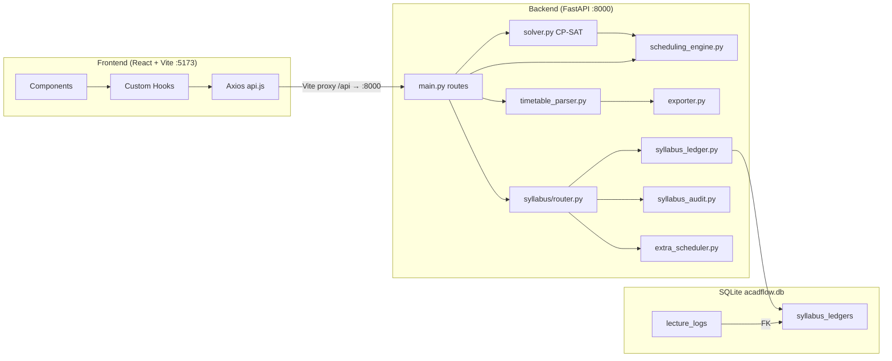
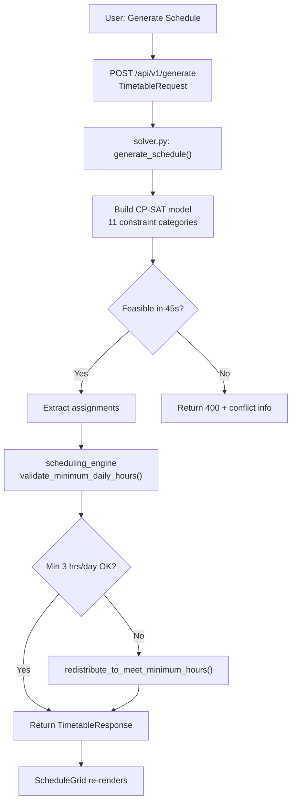
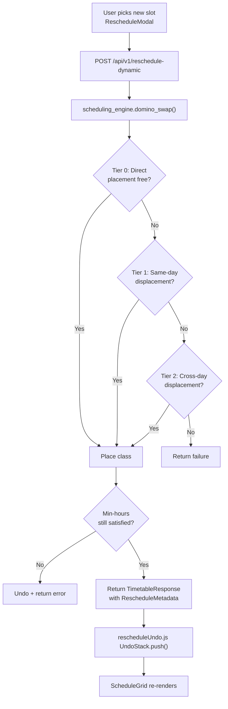
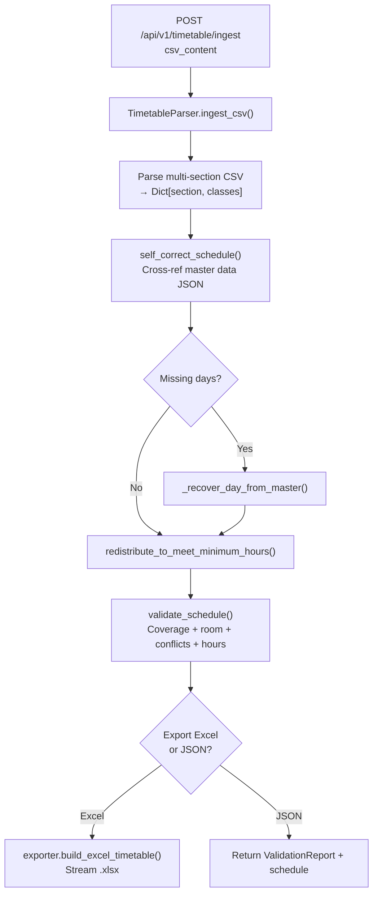
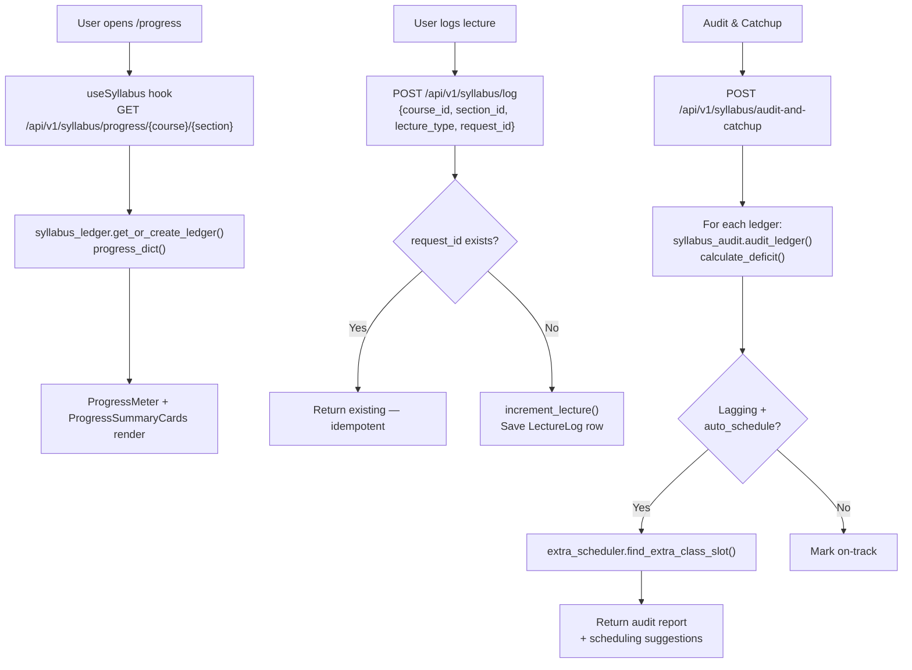
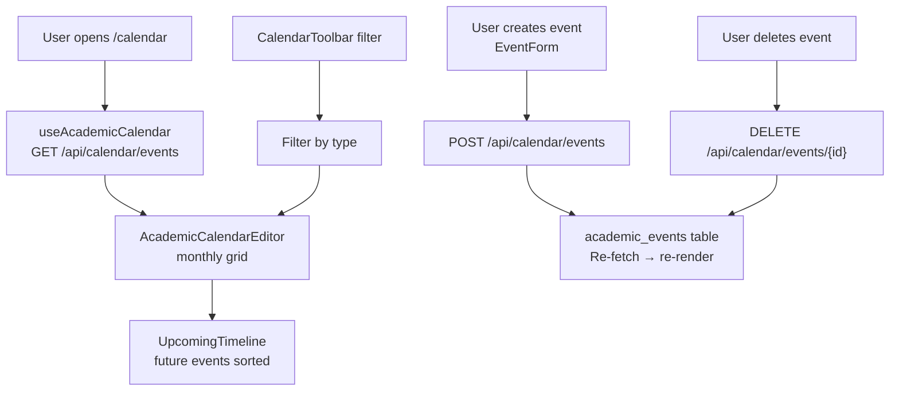
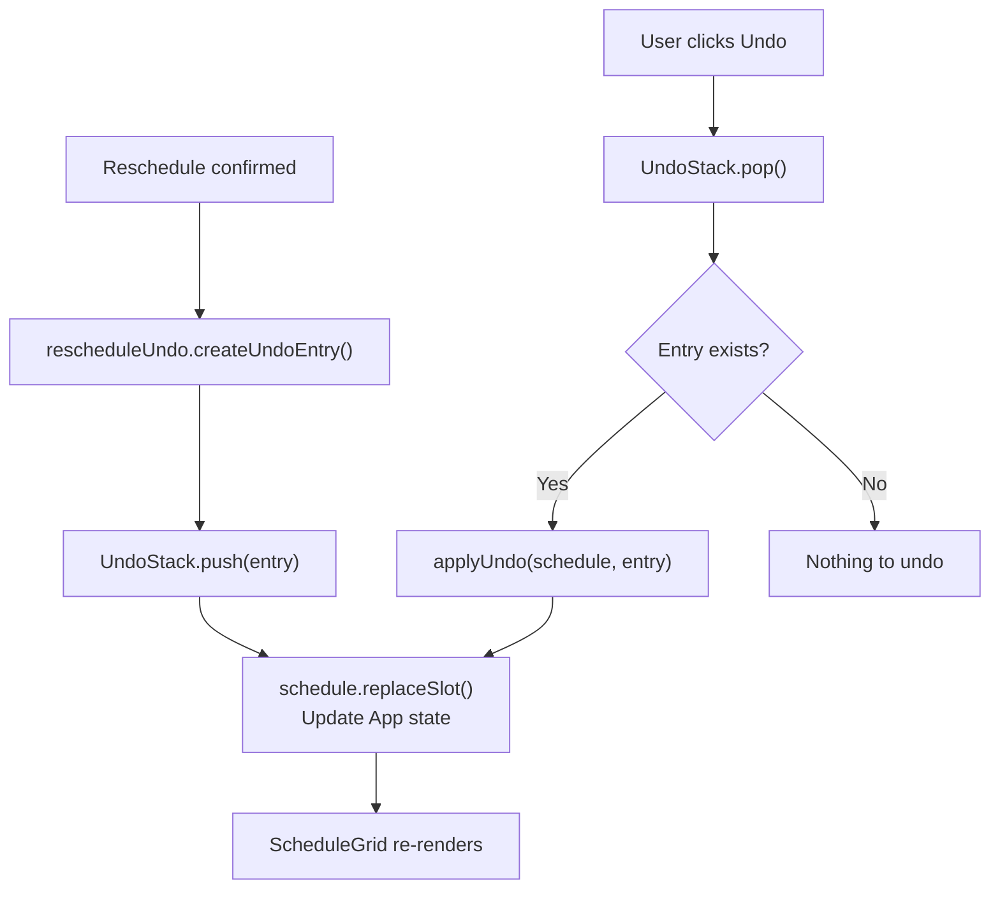
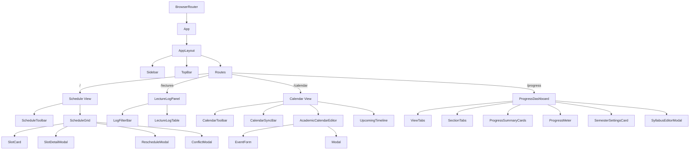

# AcadFlow — Project Description

> Full-stack academic scheduling & progress tracking system built with FastAPI + React.

---

## Table of Contents

1. [Project Overview](#1-project-overview)
2. [Tech Stack](#2-tech-stack)
3. [Project Structure](#3-project-structure)
4. [Backend Files](#4-backend-files)
5. [Frontend Files](#5-frontend-files)
6. [Scripts & Config](#6-scripts--config)
7. [Database Schema](#7-database-schema)
8. [API Endpoints](#8-api-endpoints)
9. [Flow Diagrams](#9-flow-diagrams)
10. [Component Hierarchy](#10-component-hierarchy)
11. [Frontend ↔ Backend API Mapping](#11-frontend--backend-api-mapping)
12. [Disconnected & Unused Code](#12-disconnected--unused-code)

---

## 1. Project Overview

**AcadFlow** is a university academic management platform. It auto-generates conflict-free timetables using constraint solving, tracks syllabus progress per course/section, logs lectures, manages academic calendar events, and can ingest + self-correct CSV timetables.

| Feature | Description |
|---|---|
| Timetable Generation | CP-SAT solver with 11 constraint categories |
| Dynamic Rescheduling | Multi-tier domino-swap (direct → same-day → cross-day) |
| Extra Class Scheduling | Greedy slot finder for catch-up lectures |
| CSV Ingestion & Self-Correction | Parses uploaded CSV, recovers missing days from master data |
| Excel Export | Styled `.xlsx` timetable export |
| Syllabus Tracking | Per-course/section ledger with deficit audit |
| Lecture Logging | Idempotent log with `request_id` deduplication |
| Academic Calendar | Monthly grid + upcoming timeline |
| Undo / Conflict Detection | Client-side undo stack, solver conflict display |

---

## 2. Tech Stack

| Layer | Technology |
|---|---|
| **Backend** | Python 3.13, FastAPI, Uvicorn, SQLAlchemy, SQLite, Pydantic v2, Google OR-Tools (CP-SAT), openpyxl |
| **Frontend** | React 18, Vite, React Router DOM, Axios, Tailwind CSS, date-fns, Lucide React |
| **Testing** | Pytest + httpx (30 backend tests), Vitest + Testing Library (76 frontend tests) |

---

## 3. Project Structure

```
Major Project/
├── Backend/
│   ├── main.py                      # FastAPI app — 7 route handlers
│   ├── solver.py                    # OR-Tools CP-SAT solver (11 constraints)
│   ├── scheduling_engine.py         # Domino-swap engine + min-hours redistribution
│   ├── timetable_parser.py          # CSV ingestion, self-correction, validation (599 lines)
│   ├── exporter.py                  # Styled Excel export via openpyxl
│   ├── models/
│   │   ├── __init__.py              # Re-exports all schemas + ORM models
│   │   ├── database_models.py       # SQLAlchemy: syllabus_ledgers, lecture_logs
│   │   └── schemas.py               # Pydantic schemas (Course, TimetableRequest, …)
│   ├── syllabus/
│   │   ├── __init__.py              # Re-exports all sub-module APIs
│   │   ├── router.py                # Syllabus sub-router (3 endpoints)
│   │   ├── syllabus_audit.py        # Linear-progress deficit calculation
│   │   ├── syllabus_ledger.py       # Ledger CRUD + progress summary
│   │   └── extra_scheduler.py       # Greedy extra-class slot finder
│   ├── test_main.py                 # 15 integration tests
│   ├── test_parser.py               # 9 parser/engine tests
│   └── test_syllabus.py             # 9 syllabus tests
│
├── frontend/
│   ├── package.json                 # acadflow-frontend
│   ├── vite.config.js               # Vite + proxy /api → localhost:8000
│   ├── vitest.config.js
│   └── src/
│       ├── main.jsx                 # React entry
│       ├── App.jsx                  # 4 routes + lifted state
│       ├── api.js                   # Axios instance (baseURL: "/api")
│       ├── components/
│       │   ├── calendar/            # AcademicCalendarEditor, CalendarToolbar, CalendarSyncBar, EventForm, UpcomingTimeline
│       │   ├── layout/              # AppLayout, Sidebar, TopBar
│       │   ├── lectures/            # LectureLogPanel, LectureLogTable, LogFilterBar
│       │   ├── progress/            # ProgressDashboard, ProgressMeter, ProgressSummaryCards, SemesterSettingsCard, SyllabusEditorModal, statusMeta
│       │   ├── schedule/            # ScheduleGrid, ScheduleToolbar, SlotCard, SlotDetailModal, RescheduleModal, ConflictModal
│       │   └── ui/                  # Modal, SectionTabs, ViewTabs, Toast ⚠️, DataSourceBadge ⚠️, ViewHeader ⚠️
│       ├── data/                    # academicCalendar, lectureStatus, sampleLogs, samplePayload, sampleSyllabus, prebuiltSchedule ⚠️, sampleSchedule ⚠️
│       ├── hooks/                   # useAcademicCalendar, useLectureLogs, useSyllabus, useResource ⚠️
│       ├── utils/                   # calendar, download, lectureLogs, progress, rescheduleUndo, schedule, slotAvailability
│       └── test/                    # memoryStorage, mockAdapter
│
├── scripts/
│   ├── generate_validated_timetable.py   # Runs TimetableParser → JSON + Excel output
│   ├── convert_json_to_schedule.py       # Converts validated JSON → prebuiltSchedule.js
│   └── start_backend.bat                 # Starts uvicorn on port 8000
│
├── .githooks/commit-msg             # Strips "Made-with: Cursor" from commits
├── requirements.txt                 # Python deps (no version pins)
├── package-lock.json                # ⚠️ Root-level empty stub — no matching package.json
└── acadflow.db                      # SQLite database
```

> ⚠️ items are unused or vestigial — see [Section 12](#12-disconnected--unused-code).

---

## 4. Backend Files

### `main.py`
FastAPI entry point. Sets up CORS (`localhost:5173`, `127.0.0.1:5173`), mounts `syllabus.router` at `/api/v1/syllabus`, defines 7 route handlers. Calls `generate_schedule` → `build_excel_timetable` → `TimetableParser` as needed.

### `solver.py`
Core CP-SAT solver. Creates boolean assignment variables and enforces 11 constraint categories:

| ID | Constraint |
|---|---|
| A | Room assignment (lab vs theory) |
| A2 | Pinned slots (`fixed_period`) |
| B | Early start (period 0 or 1) |
| C | Recess — exactly 1 in P3/P4 |
| D | Continuous 2-period lab blocks |
| E | Parallel electives co-scheduling |
| F | No room / teacher double-booking |
| G | Max 1 lab per day per section |
| H | Load balance + ≥3 contact hours (hard) |
| I | No internal day gaps per section |
| J | Max 4 hours/day per teacher |
| K | Max 2 theory periods/day per subject |

Solver timeout: **45 seconds**. Entry: `generate_schedule(data: TimetableRequest) -> dict`

### `scheduling_engine.py`
Post-generation engine (~514 lines, standalone). Key functions:

| Function | Purpose |
|---|---|
| `domino_swap(...)` | Multi-tier rescheduling: direct → Tier1 (same-day) → Tier2 (cross-day) |
| `validate_slot_availability(...)` | Check if a day/period is free for a section + teachers |
| `validate_minimum_daily_hours(...)` | Ensure ≥ min hours/day per section |
| `redistribute_to_meet_minimum_hours(...)` | Move classes from heavy days to deficit days |
| `evaluate_schedule_fitness(...)` | Score a schedule (penalises deficit days) |

Dataclasses: `SlotCheck`, `Move`, `DominoResult`

### `timetable_parser.py`
CSV ingestion + self-correction engine (~599 lines). Class `TimetableParser`:

| Method | Purpose |
|---|---|
| `ingest_csv(csv_content)` | Parse multi-section CSV → `Dict[section, List[ScheduledClass]]` |
| `self_correct_schedule(schedule)` | Recover missing days from master JSON data |
| `validate_schedule(schedule)` | Full validation: coverage, room types, conflicts, min hours |
| `process_and_generate(csv_content)` | Full pipeline: ingest → correct → validate → Excel/JSON |

> ⚠️ `import re` is present but never used anywhere in the file.

### `exporter.py`
`build_excel_timetable(request: ExportRequest) -> io.BytesIO` — Styled multi-sheet openpyxl workbook. Used by `main.py`'s Excel endpoints.

### `models/database_models.py`
Two SQLAlchemy ORM tables — `syllabus_ledgers` and `lecture_logs`. See [Section 7](#7-database-schema).

### `models/schemas.py`
Pydantic v2 schemas. Key ones:

| Schema | Used By |
|---|---|
| `Course` | `TimetableRequest` — has `@model_validator` to derive hours from credits |
| `TimetableRequest` | `POST /api/v1/generate` |
| `ScheduledClass` | Core unit of a scheduled slot |
| `MoveDetail` / `RescheduleMetadata` | Domino-swap response |
| `TimetableResponse` | Unified response for generate/reschedule/extra |
| `RescheduleRequest` | `POST /api/v1/reschedule-dynamic` |
| `ExtraClassRequest` | `POST /api/v1/schedule-extra` |
| `ExportRequest` | `POST /api/v1/export/excel` |
| `TimetableIngestRequest` | `POST /api/v1/timetable/ingest` |

### `syllabus/router.py`
Sub-router mounted at `/api/v1/syllabus`. Imports from `syllabus_ledger`, `syllabus_audit`, `extra_scheduler`. Local schemas: `LectureLogRequest`, `AuditRequest`.

### `syllabus/syllabus_ledger.py`
- `get_or_create_ledger(db, course_id, section_id)` — upsert
- `progress_dict(ledger)` — returns completion summary dict
- `increment_lecture(ledger, lecture_type)` — with overflow guard

### `syllabus/syllabus_audit.py`
Standalone. `calculate_deficit(completed, current_week, total_weeks)` — linear trajectory. `audit_ledger(ledger, current_week, total_weeks)` — wraps with ledger fields.

### `syllabus/extra_scheduler.py`
Standalone. `find_extra_class_slot(current_schedule, section, teachers, is_lab, all_rooms, ...)` — greedy conflict-free slot finder. Returns `{success, day, period, room}`.

### Test Files

| File | Tests | Coverage |
|---|---|---|
| `test_main.py` | 15 | Credits mapping, generate, reschedule, extra-class, Excel export, ingest |
| `test_parser.py` | 9 | CSV ingestion, self-correction, room-type, min-hours, domino-swap guard |
| `test_syllabus.py` | 9 | Deficit calc, ledger increment, extra-slot, log/progress/audit endpoints |

---

## 5. Frontend Files

### Entry & App Shell

| File | Purpose |
|---|---|
| `main.jsx` | Renders `<App>` in `<BrowserRouter>` |
| `App.jsx` | 4 routes; lifts `schedule` + `events` state; wraps in `<AppLayout>` |
| `api.js` | Axios instance `baseURL: "/api"` — Vite proxies to `:8000` |

### Components

| Component | Route | Purpose |
|---|---|---|
| `ScheduleGrid` | `/` | Weekly timetable grid; click → detail; drag → reschedule |
| `ScheduleToolbar` | `/` | Generate / Load / Clear / Export; uses `samplePayload.js` |
| `SlotCard` | `/` | Single timetable cell |
| `SlotDetailModal` | `/` | Slot detail + reschedule trigger |
| `RescheduleModal` | `/` | Pick alternative slot using `slotAvailability.js` |
| `ConflictModal` | `/` | Display solver conflicts |
| `LectureLogPanel` | `/lectures` | Container; uses `useLectureLogs` hook |
| `LectureLogTable` | `/lectures` | Table + inline status dropdown |
| `LogFilterBar` | `/lectures` | Filter by subject and status |
| `AcademicCalendarEditor` | `/calendar` | Monthly grid + event CRUD |
| `CalendarToolbar` | `/calendar` | Type filter buttons |
| `CalendarSyncBar` | `/calendar` | Sync-status badge |
| `EventForm` | `/calendar` | Create/edit event |
| `UpcomingTimeline` | `/calendar` | Sorted future events list |
| `ProgressDashboard` | `/progress` | Main; uses `useSyllabus` hook |
| `ProgressMeter` | `/progress` | Completion % ring/bar |
| `ProgressSummaryCards` | `/progress` | Total/done/wip/todo cards |
| `SemesterSettingsCard` | `/progress` | ⚠️ No backend — frontend-only |
| `SyllabusEditorModal` | `/progress` | Edit syllabus units & topics |
| `statusMeta` | `/progress` | Constant: status → label/color/icon |
| `Modal` | shared | Generic modal wrapper |
| `SectionTabs` | shared | In-section tab nav |
| `ViewTabs` | shared | Top-level tab nav |
| `Toast` | shared | ⚠️ Underused — many errors still use `alert()` |
| `DataSourceBadge` | — | ⚠️ **Never imported** |
| `ViewHeader` | — | ⚠️ **Never imported** |

### Custom Hooks

| Hook | API Calls | Fallback | Issue |
|---|---|---|---|
| `useAcademicCalendar` | `GET/POST/DELETE /calendar/events` | `academicCalendar.js` | ✅ OK |
| `useLectureLogs` | `GET/POST /lectures/log`, `PUT /lectures/log/{id}` | `sampleLogs.js` | 🔴 PUT has no backend endpoint |
| `useSyllabus` | `GET/POST /syllabus/{subject}`, `PUT /topic-status`, `GET /audit` | `sampleSyllabus.js` | ✅ OK |
| `useResource` | Generic CRUD factory | — | ⚠️ **Never imported** |

### Utils

| Module | Key Exports |
|---|---|
| `calendar.js` | `getDaysInMonth`, `formatDateForAPI`, `isToday`, `isFutureDate`, `getEventTypeColor` |
| `download.js` | `downloadAsCSV`, `downloadAsJSON` (client-side blob) |
| `lectureLogs.js` | `groupLogsBySubject`, `filterLogs`, `getStatusCounts` |
| `progress.js` | `computeProgress`, `getProgressColor`, `formatAuditForDisplay` |
| `rescheduleUndo.js` | `UndoStack` class, `createUndoEntry`, `applyUndo` |
| `schedule.js` | `groupScheduleByDay`, `findSlot`, `replaceSlot` |
| `slotAvailability.js` | `getAvailableSlots`, `isSlotAvailable`, `getSlotsForFaculty` |

### Data Files

| File | Export | Status |
|---|---|---|
| `samplePayload.js` | `SAMPLE_PAYLOAD` | ✅ Used by ScheduleToolbar |
| `academicCalendar.js` | `SAMPLE_CALENDAR_EVENTS` | ✅ Fallback |
| `sampleLogs.js` | `SAMPLE_LOGS` | ✅ Fallback |
| `sampleSyllabus.js` | `SAMPLE_SYLLABUS` | ✅ Fallback |
| `lectureStatus.js` | `LECTURE_STATUSES` | ✅ Used in lecture components |
| `prebuiltSchedule.js` | `PREBUILT_SCHEDULE` | ⚠️ Never imported at runtime |
| `sampleSchedule.js` | `SAMPLE_SCHEDULE` | ⚠️ Never imported — older version |

---

## 6. Scripts & Config

| File | Purpose | Status |
|---|---|---|
| `start_backend.bat` | Activates `.venv`, runs `uvicorn main:app --reload --port 8000` | ✅ Active |
| `generate_validated_timetable.py` | Runs `TimetableParser.process_and_generate()` → writes `data/aiml_sem5_timetable_validated.json` + Excel | ✅ Dev pipeline |
| `convert_json_to_schedule.py` | Reads validated JSON → writes `frontend/src/data/prebuiltSchedule.js` | ✅ Dev pipeline |
| `.githooks/commit-msg` | Strips `Made-with: Cursor` trailer from commits; needs `git config core.hooksPath .githooks` | ✅ Active if configured |
| `requirements.txt` | `fastapi uvicorn ortools pandas openpyxl pydantic sqlalchemy pytest httpx` — no version pins | ✅ Active |
| `package-lock.json` (root) | Empty lockfile — no root `package.json` | ⚠️ Vestigial |

**Scripts pipeline:**
```
generate_validated_timetable.py
    → data/aiml_sem5_timetable_validated.json
         → convert_json_to_schedule.py
              → frontend/src/data/prebuiltSchedule.js  (⚠️ never imported at runtime)
```

---

## 7. Database Schema

**Engine:** SQLite via SQLAlchemy ORM — `acadflow.db`

```
┌──────────────────────────────────────┐
│         syllabus_ledgers             │
├──────────────────────────────────────┤
│ id               INTEGER  PK         │
│ course_id        VARCHAR  (indexed)  │
│ section_id       VARCHAR  (indexed)  │
│ regular_target   INTEGER  default 36 │
│ extra_target     INTEGER  default 3  │
│ regular_completed INTEGER  default 0 │
│ extra_completed  INTEGER  default 0  │
│ extra_scheduled  INTEGER  default 0  │
│ updated_at       DATETIME            │
│ UNIQUE (course_id, section_id)       │
└──────────────────┬───────────────────┘
                   │  1 : many  (cascade delete-orphan)
                   ▼
┌──────────────────────────────────────┐
│           lecture_logs               │
├──────────────────────────────────────┤
│ id           INTEGER  PK             │
│ ledger_id    INTEGER  FK             │
│ lecture_type VARCHAR                 │
│ request_id   VARCHAR  UNIQUE nullable│  ← idempotency key
│ completed_at DATETIME                │
└──────────────────────────────────────┘
```

> `request_id` on `lecture_logs` provides idempotency — logging the same lecture twice with the same `request_id` is a no-op.

---

## 8. API Endpoints

### Core Timetable (`main.py`)

| Method | Path | Request Schema | Response | Description |
|---|---|---|---|---|
| `GET` | `/` | — | `{name, status, docs_url}` | Health check |
| `POST` | `/api/v1/generate` | `TimetableRequest` | `TimetableResponse` | CP-SAT generation + min-hours redistribution |
| `POST` | `/api/v1/reschedule-dynamic` | `RescheduleRequest` | `TimetableResponse` | Domino-swap rescheduling |
| `POST` | `/api/v1/schedule-extra` | `ExtraClassRequest` | `TimetableResponse` | Find slot for extra class |
| `POST` | `/api/v1/export/excel` | `ExportRequest` | `.xlsx` stream | Styled Excel export |
| `POST` | `/api/v1/timetable/ingest` | `TimetableIngestRequest` | JSON report | CSV → parse → self-correct → validate |
| `POST` | `/api/v1/timetable/ingest/excel` | `TimetableIngestRequest` | `.xlsx` stream | CSV → parse → self-correct → Excel |

### Syllabus (`syllabus/router.py` — prefix `/api/v1/syllabus`)

| Method | Path | Description |
|---|---|---|
| `POST` | `/api/v1/syllabus/log` | Log completed lecture (idempotent via `request_id`) |
| `GET` | `/api/v1/syllabus/progress/{course_id}/{section_id}` | Get progress summary |
| `POST` | `/api/v1/syllabus/audit-and-catchup` | Deficit audit + optional auto-schedule extras |

---

## 9. Flow Diagrams

### 9.1 High-Level Architecture



### 9.2 Timetable Generation Flow



### 9.3 Domino-Swap Rescheduling



### 9.4 CSV Timetable Ingestion & Self-Correction



### 9.5 Syllabus Progress & Audit Flow



### 9.6 Academic Calendar Flow



### 9.7 Reschedule Undo Flow



---

## 10. Component Hierarchy



---

## 11. Frontend ↔ Backend API Mapping

| Frontend Caller | Method | Path Called | Backend Endpoint | Status |
|---|---|---|---|---|
| `ScheduleToolbar` | `POST` | `/schedule/generate` | `POST /api/v1/generate` | ⚠️ Path prefix mismatch — verify proxy |
| `ScheduleToolbar` | `GET` | `/schedule/saved` | No matching endpoint in backend | 🔴 Missing |
| `ScheduleToolbar` | `DELETE` | `/schedule/clear` | No matching endpoint in backend | 🔴 Missing |
| `useAcademicCalendar` | `GET` | `/calendar/events` | `GET /api/calendar/events` | ✅ Connected |
| `useAcademicCalendar` | `POST` | `/calendar/events` | `POST /api/calendar/events` | ✅ Connected |
| `useAcademicCalendar` | `DELETE` | `/calendar/events/{id}` | `DELETE /api/calendar/events/{id}` | ✅ Connected |
| `useLectureLogs` | `GET` | `/lectures/log` | `GET /api/lectures/log` | ✅ Connected |
| `useLectureLogs` | `POST` | `/lectures/log` | `POST /api/lectures/log` | ✅ Connected |
| `useLectureLogs` | `PUT` | `/lectures/log/{id}` | No matching endpoint | 🔴 Broken |
| `useSyllabus` | `GET` | `/syllabus/{subject}` | `GET /api/v1/syllabus/progress/{course}/{section}` | ⚠️ Path mismatch |
| `useSyllabus` | `POST` | `/syllabus/{subject}` | `POST /api/v1/syllabus/log` | ⚠️ Schema mismatch |
| `useSyllabus` | `PUT` | `/syllabus/{subject}/topic-status` | No matching endpoint | 🔴 Broken |
| `useSyllabus` | `GET` | `/syllabus/{subject}/audit` | `POST /api/v1/syllabus/audit-and-catchup` | ⚠️ Method + path mismatch |

> **Root cause:** The frontend was written against an older API contract (`/api/syllabus/{subject}`)
> while the backend evolved to `/api/v1/` prefix with a different resource model.

---

## 12. Disconnected & Unused Code

### 🔴 Broken — Frontend calls non-existent endpoints

| Item | File | Detail |
|---|---|---|
| `updateLogStatus()` | `useLectureLogs.js` | Calls `PUT /api/lectures/log/{id}` — no such backend route |
| Syllabus topic-status PUT | `useSyllabus.js` | Calls `PUT /syllabus/{subject}/topic-status` — not in backend |
| `GET/POST /schedule/saved` & `/schedule/clear` | `ScheduleToolbar.jsx` | Frontend uses old-style paths; backend uses `/api/v1/` prefix — needs verification |

### 🟡 Unused Backend Code

| Item | File | Detail |
|---|---|---|
| `import re` | `timetable_parser.py` | Imported, never used |
| `pandas` | `requirements.txt` | Listed, never imported anywhere in backend |
| `TimetableIngestRequest.export_excel` | `schemas.py` | Defined but never checked in `main.py` — two separate ingest routes handle it instead |
| Hardcoded "V C Thursday" fallback | `timetable_parser.py` lines 316–337 | University-specific, not general-purpose |
| Hardcoded course→teacher→room map | `timetable_parser.py` lines 373–392 | Tightly coupled to specific CSV format |

### 🟡 Unused Frontend Code

| Item | Type | Detail |
|---|---|---|
| `DataSourceBadge.jsx` | Component | Never imported |
| `ViewHeader.jsx` | Component | Never imported — views use inline headers |
| `useResource.js` | Hook | Generic CRUD hook, never imported |
| `prebuiltSchedule.js` | Data file | Generated by scripts pipeline but never imported at runtime |
| `sampleSchedule.js` | Data file | Older version — never imported |
| `Toast.jsx` | Component | Defined but most error handlers use `alert()` instead |

### 🟡 Frontend-Only State (No Backend Persistence)

| Component | Detail |
|---|---|
| `SemesterSettingsCard` | Semester start/end/lecture-days config — no backend endpoint, lost on refresh |

### 🟡 Vestigial Config

| File | Detail |
|---|---|
| `package-lock.json` (project root) | Empty `packages: {}` — no matching root `package.json`. Can be deleted. |

### Summary

| Severity | Issue | Count |
|---|---|---|
| 🔴 Broken | Frontend→Backend path/method mismatches | 4 |
| 🟡 Unused | Backend imports & requirements | 2 |
| 🟡 Unused | Frontend components never imported | 2 |
| 🟡 Unused | Frontend hooks/data files never imported | 3 |
| 🟡 Hardcoded | University-specific parser logic | 2 |
| 🟡 No persistence | Frontend-only state | 1 |
| 🟡 Vestigial | Config files | 1 |

---

> **Generated:** 2026-11-11 | Codebase: ~2,900 LOC backend · ~3,500 LOC frontend · 30 backend tests · 76 frontend tests
